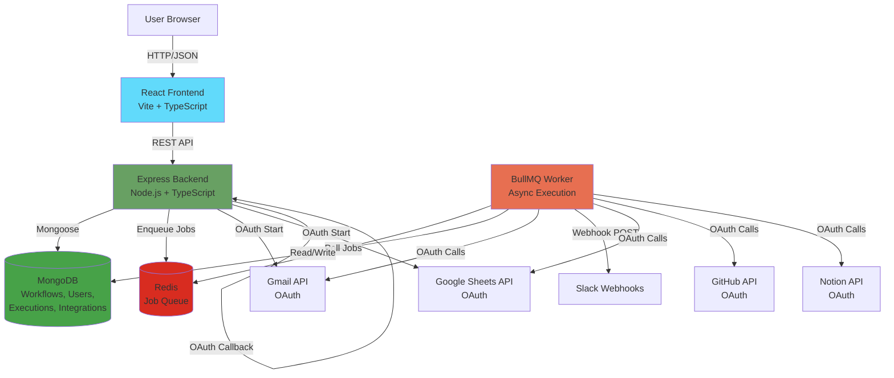
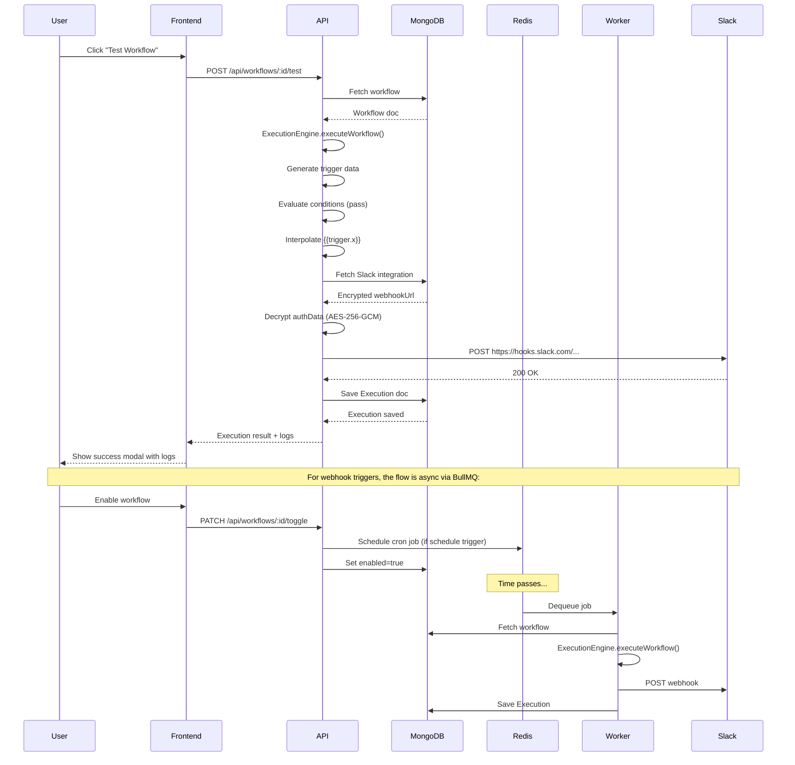
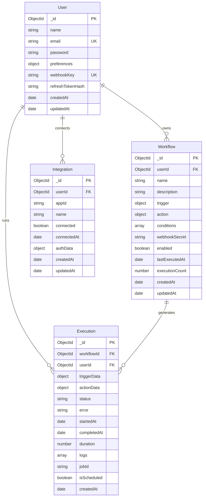

# WorkSync Project Documentation

## 1. What Is This Project

WorkSync is a workflow automation platform that connects different web applications and automates tasks between them without requiring any code. Think of it like a personal assistant that watches for specific events (like receiving an email or a new spreadsheet row) and automatically takes actions in response (like sending a Slack message or creating a GitHub issue).

The platform is designed for business users, developers, and teams who want to eliminate repetitive manual work. Instead of copying data between apps or remembering to notify your team every time something happens, you set up a workflow once and WorkSync handles it automatically from that point forward.

At its core, it's like Zapier or Make.com, but built as a complete full-stack application with real-time execution, detailed audit logs, and support for both simulated testing and live webhook triggers.

## 2. Why It's Useful / Core Value Proposition

WorkSync eliminates the tedious context-switching and manual data entry that wastes hours every week. Here's what users can actually do with the current implementation:

**Gmail to Slack Notification**: When an email arrives in your Gmail inbox (optionally filtered by subject or sender), WorkSync can automatically post a formatted message to a Slack channel with details like the sender, subject line, and email snippet. This is implemented using OAuth-authenticated Gmail monitoring and Slack incoming webhooks.

**Google Sheets to Discord Alert**: When a new row is added to a Google Sheets spreadsheet (like a form submission or sales lead), WorkSync can send a Discord message to your team channel with the row data. Both the Google Sheets trigger and Discord webhook action are fully implemented.

**GitHub Issue to Slack**: When a new issue is opened in a GitHub repository, WorkSync can automatically notify your team's Slack channel with the issue title, author, and link. This uses the GitHub webhook trigger and Slack messaging action.

**Scheduled Reports**: WorkSync can run workflows on a schedule (hourly, daily, weekly) using cron patterns. For example, send a daily summary email via Gmail or post weekly metrics to Microsoft Teams. The schedule trigger with BullMQ job scheduling is fully operational.

All of these workflows support conditional filtering (only process emails with specific subjects, only alert for high-priority rows) and dynamic variable interpolation (pull sender names, spreadsheet values, or GitHub data into your messages using `{{trigger.fieldName}}` syntax). Each execution is logged with millisecond precision, showing exactly what data came in, whether conditions passed, and what action was taken.

## 3. High-Level Architecture

WorkSync is built as a three-tier architecture with a React frontend, Express/Node.js backend API, a MongoDB database for persistence, Redis for job queuing, and BullMQ workers for asynchronous execution. External integrations happen through OAuth flows and webhook callbacks.



The frontend runs on port 5173 (development) or 80 (production), the backend API runs on port 5000, MongoDB runs on port 27017, and Redis runs on port 6379. All services are orchestrated through Docker Compose in production with health checks and automatic restarts.

## 4. Core Workflow Explanation (the actual product logic)

### a) Building a Workflow in the UI

The user navigates to `/workflows/create` and goes through a six-step wizard. In step 1, they enter a workflow name like "New Lead Alerts" and optional description. In step 2, they select a trigger app (let's say "Google Sheets") and event ("New Row Added"). In step 3, they configure trigger parameters — for Google Sheets, that means entering the spreadsheet ID and sheet name. In step 4, they choose an action app (let's say "Slack") and action ("Send Message"). In step 5, they configure the action parameters: the Slack webhook URL and the message text. This is where variable interpolation comes in.

### b) Variable Interpolation Syntax

The user types a message like: "New lead from `{{trigger.data.Customer Name}}` at `{{trigger.data.Company}}` — MRR: `{{trigger.data.MRR}}`". When they submit, the frontend sends this structure to `POST /api/workflows`:

```json
{
  "name": "New Lead Alerts",
  "trigger": {
    "app": "google_sheets",
    "event": "new_row",
    "parameters": {
      "spreadsheetId": "1BxiMVs0XRA5nFMdKvBdBZjgmUUqptlbs74OgvE2upms",
      "sheetName": "Leads"
    }
  },
  "action": {
    "app": "slack",
    "action": "send_message",
    "parameters": {
      "message": "New lead from {{trigger.data.Customer Name}} at {{trigger.data.Company}} — MRR: {{trigger.data.MRR}}"
    }
  },
  "conditions": []
}
```

The backend `workflowController.createWorkflow` validates this, generates a unique `webhookId` for the workflow (used later for webhook triggers), encrypts any sensitive data, and saves it to the `Workflow` collection in MongoDB.

### c) Workflow Triggering

There are three ways a workflow gets triggered:

**Manual Test**: The user clicks "Test Now" in the UI, which calls `POST /api/workflows/:id/test`. The controller immediately calls `ExecutionEngine.executeWorkflow()` with simulated trigger data and returns the result synchronously for instant feedback.

**Webhook Trigger**: For webhook-based workflows, WorkSync generates a unique URL like `https://api.worksync.io/api/workflows/webhook/wh_abc123xyz`. When an external service POSTs to this URL, the `workflowController.handleWebhook` function looks up the workflow by `webhookId`, validates the webhook signature (HMAC-SHA256 using the workflow's stored `webhookSecret`), extracts the incoming JSON payload, and enqueues an execution job to BullMQ via `enqueueWorkflowExecution()`.

**Scheduled Trigger**: For schedule-based workflows, when the workflow is created or enabled, `scheduleRepeatableJob()` registers a cron pattern with BullMQ (e.g., `"0 9 * * *"` for 9am daily). BullMQ automatically enqueues jobs at those intervals.

### d) Execution Engine Processing

When a job is dequeued by the BullMQ worker (in `executionWorker.ts`), the worker fetches the workflow from MongoDB, checks if it's still enabled, then calls `ExecutionEngine.executeWorkflow()`.

The execution engine does four things in order:

**Step 1 - Trigger**: It generates or receives trigger data. For simulated tests, `generateSimulatedTriggerData()` creates realistic fake data based on the trigger app (for Google Sheets, it generates a mock row with Customer Name, Company, MRR fields). For live webhooks, it uses the actual POST body. This data becomes the `triggerData` object. A log entry is created: `{ step: 'trigger', title: 'New spreadsheet row detected', status: 'success', data: triggerData }`.

**Step 2 - Conditions**: It evaluates any conditions using `evaluateConditions()`. If conditions exist (like "trigger.data.Status equals Active"), it walks the `triggerData` object to extract the field value and compares it using the operator. If conditions fail, it logs a "skipped" status and creates an Execution record with `status: 'success'` but `actionData.skipped: true`, then exits without running the action.

**Step 3 - Interpolation**: It calls `interpolateVariables()` on the action parameters. This function recursively walks through the parameters object, finds any string containing `{{trigger.x.y.z}}` patterns, extracts the value from `triggerData` by splitting on dots and navigating the object, and replaces the placeholder with the actual value. So `{{trigger.data.Customer Name}}` becomes "Sarah Connor" from the trigger data.

**Step 4 - Action**: It calls `executeActionMock()`, which checks if `hasRealIntegration(app)` returns true. If yes (Slack, Gmail, Google Sheets, GitHub, Notion are all real), it calls `executeIntegrationAction()` from `integrations/index.ts`, which dispatches to the specific handler (like `sendSlackMessage()` in `integrations/slack.ts`).

### e) Real Third-Party Action Execution (Slack Example)

Let's trace a real Slack message through the code:

`executeIntegrationAction('slack', 'send_message', userId, { message: 'New lead from Sarah Connor...' })` is called. This routes to `sendSlackMessage()` in `integrations/slack.ts`.

First, it calls `getCredentials(userId, 'slack')`, which queries the `Integration` collection for this user's Slack integration, decrypts the stored `authData` using AES-256-GCM (via `decrypt()` from `utils/crypto.ts`), and extracts the `webhookUrl` (the Slack Incoming Webhook URL the user pasted when connecting Slack).

Then it validates the URL format (must be `https://hooks.slack.com/...`) using `assertHttpUrl()`.

It constructs the payload: `{ text: 'New lead from Sarah Connor at Cyberdyne Systems — MRR: $1,250' }`, and POSTs it to Slack's webhook URL using `safeRequest()` (an axios wrapper that catches network errors and maps them to `IntegrationError` with retry logic).

Slack responds with HTTP 200 and "ok". The function returns `{ message: 'Slack notification sent successfully', data: { text, status: 200 } }`. This becomes an action log entry with `status: 'success'`.

If Slack returned a 429 (rate limit), `safeRequest()` would throw an `IntegrationError` with `retryable: true`, which bubbles up to the worker. The worker catches it, checks `error.retryable`, and re-throws it so BullMQ automatically retries with exponential backoff (2s, 4s, 8s, up to 3 attempts). If it was a 400 (bad request), `retryable: false`, the worker wraps it in `UnrecoverableError` to fail immediately without retries.

### f) Result Logging and Task History

After the action completes (or fails), the execution engine creates an `Execution` document in MongoDB with:
- `workflowId`, `userId`, `triggerData`, `actionData`
- `status: 'success' | 'failed'`
- `startedAt`, `completedAt`, `duration` (in milliseconds)
- `logs` array with all step entries (trigger, condition, action)
- `jobId` (the BullMQ job ID for tracking)

It also increments the workflow's `executionCount` and updates `lastExecutedAt`.

When the user visits `/history`, the frontend calls `GET /api/history`, which returns a paginated list of executions sorted by `startedAt` descending. Clicking an execution opens a drawer that shows the full JSON logs, timestamps, and duration breakdown. The UI displays success/failed badges, the workflow name, trigger/action apps, and a timeline visualization.



## 5. Authentication & Security Flow

**Registration and Login**: When a user registers via `POST /api/auth/register`, the backend hashes their password with bcrypt (10 salt rounds), creates a User document in MongoDB, auto-seeds demo workflows for them via `SeedService.seedUserData()`, and generates two tokens: an access token (JWT, 15-minute expiry) and a refresh token (JWT, 7-day expiry). The access token contains `{ id, email, name }` and is signed with `JWT_SECRET`. The refresh token contains `{ id, typ: 'refresh', jti: <random hex> }` and is signed with `JWT_REFRESH_SECRET`. The refresh token is hashed with SHA-256 and stored in the User's `refreshTokenHash` field. The refresh token itself is set as an httpOnly cookie named `worksync_refresh` with `sameSite: strict` and `secure: true` in production. The access token is returned in the JSON response for the frontend to store in memory.

**Authenticated Requests**: Every protected route uses the `auth` middleware (in `middleware/auth.ts`), which extracts the access token from the `Authorization: Bearer <token>` header, verifies it with `jwt.verify()`, and attaches the decoded user to `req.user`. If the token is expired or invalid, it returns 401.

**Token Refresh**: When the access token expires, the frontend calls `POST /api/auth/refresh` with the httpOnly cookie. The backend verifies the refresh token's signature and expiry, loads the user, checks that the stored `refreshTokenHash` matches SHA-256 of the presented token (constant-time comparison via `crypto.timingSafeEqual`), then rotates the refresh token: it generates a new refresh token with a new `jti`, hashes it, updates the user's `refreshTokenHash` in MongoDB using a filtered update (only if the old hash still matches, to prevent concurrent reuse), sets the new cookie, and returns a fresh access token. The rotation ensures stolen refresh tokens are invalidated after one use.

**Logout**: `POST /api/auth/logout` clears the `refreshTokenHash` in MongoDB and clears the httpOnly cookie, invalidating all sessions for that user.

**OAuth for Third-Party Apps**: Connecting Gmail, Google Sheets, GitHub, or Notion follows the OAuth 2.0 authorization code flow:

1. User clicks "Connect Gmail" in the UI. Frontend calls `POST /api/apps/gmail/oauth/start`.
2. Backend generates a signed state token using `createState(userId, 'gmail')`, which embeds a random nonce in a JWT signed with `JWT_SECRET`, valid for 10 minutes. The nonce is also set as an httpOnly cookie (`worksync_oauth_nonce`).
3. Backend returns the OAuth URL: `https://accounts.google.com/o/oauth2/v2/auth?client_id=...&redirect_uri=https://api.worksync.io/api/apps/gmail/oauth/callback&scope=https://www.googleapis.com/auth/gmail.send&access_type=offline&prompt=consent&state=<signed-jwt>`.
4. User is redirected to Google, approves permissions.
5. Google redirects back to `https://api.worksync.io/api/apps/gmail/oauth/callback?code=...&state=<signed-jwt>`.
6. Backend's `appsController.handleOAuthCallback()` verifies the state JWT signature, checks the nonce matches the cookie (constant-time), calls `exchangeCode('gmail', code)` which uses the Google OAuth SDK to exchange the code for tokens.
7. Google returns `{ access_token, refresh_token, scope }`. Backend stores `{ refreshToken, scope }` in the Integration's `authData` field. Before saving, the `integrationSchema.pre('save')` hook encrypts `authData` with AES-256-GCM using a 32-byte key from `ENCRYPTION_KEY` environment variable, producing `{ __enc: 'v1:<iv>:<tag>:<ciphertext>' }`.
8. Backend redirects the user back to the frontend with a success message.

When a workflow needs to send an email via Gmail, `sendGmail()` calls `getCredentials(userId, 'gmail')`, which fetches the Integration document and calls `.getAuthData()` (a Mongoose method), which decrypts the stored ciphertext back to `{ refreshToken, scope }`. It then uses `googleClientForRefreshToken()` to create an OAuth2 client with the refresh token, which the Google SDK automatically exchanges for a fresh access token on each API call.

**AES-256-GCM Encryption Explained**: AES-256-GCM is an authenticated encryption algorithm. It uses a 256-bit (32-byte) key to encrypt data, produces a random 12-byte initialization vector (IV), encrypts the plaintext into ciphertext, and generates a 16-byte authentication tag that proves the ciphertext hasn't been tampered with. When decrypting, it verifies the tag first, then decrypts. This ensures that even if an attacker reads the database, they cannot decrypt credentials without the `ENCRYPTION_KEY`, and they cannot modify the encrypted data without detection. The key is loaded from an environment variable and never stored in the database, so it must be backed up separately and kept secret.

## 6. Technology Stack Table

| Technology | Category | What It Does | Why Chosen |
|------------|----------|--------------|------------|
| React 18 | Frontend Framework | Builds the interactive user interface with reusable components and efficient re-rendering | Industry standard for SPAs, rich ecosystem, great developer experience |
| TypeScript | Programming Language | Adds static typing to JavaScript for both frontend and backend | Catches errors at compile time, better IDE support, self-documenting code |
| Vite | Frontend Build Tool | Bundles the React app with fast hot-reload during development and optimized production builds | Much faster than Create React App, modern ESM-based, great DX |
| Tailwind CSS | CSS Framework | Utility-first CSS classes for rapid UI development without writing custom CSS | Highly customizable, no unused CSS in production, consistent design system |
| Lucide React | Icon Library | Provides 1000+ clean, consistent SVG icons as React components | Lightweight, tree-shakable, MIT licensed, modern design |
| React Router DOM | Client-Side Routing | Handles navigation between pages without full reloads (SPA routing) | Official React routing library, supports protected routes and nested layouts |
| Node.js | Backend Runtime | JavaScript runtime built on V8 engine for server-side execution | Enables full-stack JavaScript, huge package ecosystem, async/event-driven |
| Express.js | Backend Framework | Minimalist web framework for building REST APIs with middleware support | Industry standard, flexible, large community, perfect for RESTful APIs |
| MongoDB | Database | NoSQL document database that stores JSON-like documents with flexible schemas | Schema flexibility for evolving data models, horizontal scaling, fast queries |
| Mongoose | ODM (Object Document Mapper) | Adds schema validation, type casting, and query building on top of MongoDB | Type-safe DB operations, automatic validation, middleware hooks, virtuals |
| Redis | In-Memory Data Store | Ultra-fast key-value store used as a job queue backing store | Sub-millisecond latency, persistence options, pub/sub for job queuing |
| BullMQ | Job Queue | Robust job and message queue built on Redis for async task processing | Retry logic, cron scheduling, priority queues, job persistence, concurrency control |
| bcryptjs | Password Hashing | Hashes passwords with salt and configurable work factor | Slow by design (prevents brute force), automatic salting, battle-tested |
| jsonwebtoken | JWT Library | Creates and verifies JSON Web Tokens for stateless authentication | Standard for API auth, no session storage needed, embeds claims |
| Axios | HTTP Client | Promise-based HTTP client for making requests to third-party APIs | Automatic JSON parsing, interceptors for error handling, request/response transforms |
| googleapis | Google API Client | Official Node.js client for Gmail, Google Sheets, Drive, etc. | OAuth integration, auto-generated typings, handles token refresh |
| @octokit/rest | GitHub API Client | Official GitHub REST API client for Node.js | Type-safe GitHub operations, rate limit handling, OAuth support |
| @notionhq/client | Notion API Client | Official Notion SDK for database and page operations | Native TypeScript support, clean API, OAuth integration |
| ioredis | Redis Client | Robust Redis client with cluster support, pipelining, and Lua scripts | Better than node-redis, async/await support, connection pooling |
| Helmet | Security Middleware | Sets secure HTTP headers (CSP, X-Frame-Options, etc.) to prevent attacks | Essential for production, prevents XSS/clickjacking, one-line setup |
| Express Rate Limit | Rate Limiting | Prevents abuse by limiting requests per IP address | Protects API from DoS, configurable windows and limits |
| CORS | Cross-Origin Resource Sharing | Allows frontend (different origin) to call backend API | Required for SPAs on different domains/ports, configurable origins |
| Pino | Logger | Fast, low-overhead JSON logger for production logging | Structured logging, minimal performance impact, human-readable in dev |
| Vitest | Test Framework | Modern test runner compatible with Vite's config and fast | Instant startup, ESM native, works with TypeScript out of the box |
| Docker Compose | Container Orchestration | Defines multi-container setup with networking, volumes, and health checks | One-command deployment, reproducible environments, service isolation |
| Zod | Schema Validation | Runtime type validation and parsing for API inputs | Type-safe validation, great error messages, integrates with TypeScript |

## 7. Database Schema Overview

WorkSync uses four main Mongoose models stored in MongoDB:

**User** (`models/User.ts`): Represents a registered user account. Key fields: `name` (full name), `email` (unique, lowercase), `password` (bcrypt hash), `avatar` (profile picture URL), `preferences` (object with `emailNotifications`, `workflowNotifications`, `autoRetryFailed` booleans), `webhookKey` (auto-generated unique key like `ws_abc123` used for webhook URLs), `refreshTokenHash` (SHA-256 hash of current refresh token, null when logged out, excluded from queries unless explicitly selected). Timestamps: `createdAt`, `updatedAt`. Relationships: One user has many workflows, integrations, and executions.

**Workflow** (`models/Workflow.ts`): Represents an automation workflow. Key fields: `userId` (references User), `name`, `description`, `trigger` (embedded object with `app`, `event`, `parameters`, optional `webhookId`), `action` (embedded object with `app`, `action`, `parameters`), `conditions` (array of objects with `field`, `operator`, `value`), `webhookSecret` (HMAC secret for webhook signature validation, auto-generated for webhook triggers, excluded from queries unless explicitly selected), `enabled` (boolean), `lastExecutedAt`, `executionCount`. Timestamps: `createdAt`, `updatedAt`. Relationships: One workflow belongs to one user, has many executions. Compound index on `userId` for fast user workflow queries.

**Execution** (`models/Execution.ts`): Represents a single workflow run. Key fields: `workflowId` (references Workflow), `userId` (references User), `triggerData` (JSON object with trigger payload), `actionData` (JSON object with action result), `status` (enum: 'success', 'running', 'failed', 'queued'), `error` (error message if failed), `startedAt`, `completedAt`, `duration` (milliseconds), `logs` (array of step logs with `step`, `title`, `status`, `message`, `timestamp`, `data`), `jobId` (BullMQ job ID), `isScheduled` (boolean). Timestamps: `createdAt`. Relationships: One execution belongs to one workflow and one user. Indexes on `workflowId`, `userId`, `status`, `jobId` for efficient history queries.

**Integration** (`models/Integration.ts`): Represents a connected third-party app. Key fields: `userId` (references User), `appId` (e.g., 'slack', 'gmail'), `name` (display name), `connected` (boolean), `connectedAt` (timestamp), `authData` (encrypted credentials stored as `{ __enc: string }`, never sent to frontend). Timestamps: `createdAt`, `updatedAt`. Relationships: One integration belongs to one user. Compound unique index on `userId` + `appId` ensures one integration per app per user. The `authData` field is automatically encrypted before save and decrypted via `.getAuthData()` method.

**Relationships ER Diagram**:



## 8. Folder Structure Explained

```
WorkSync/
├── backend/                      # Node.js/Express backend API
│   ├── src/
│   │   ├── controllers/          # Request handlers that process HTTP requests and return responses
│   │   ├── integrations/         # Third-party API implementations (Slack, Gmail, GitHub, etc.)
│   │   ├── middleware/           # Express middleware for auth verification and error handling
│   │   ├── models/               # Mongoose schemas defining database structure
│   │   ├── queues/               # BullMQ queue setup and job enqueueing functions
│   │   ├── routes/               # Express route definitions mapping URLs to controllers
│   │   ├── services/             # Business logic layer (ExecutionEngine, SeedService)
│   │   ├── types/                # TypeScript type definitions shared across backend
│   │   ├── utils/                # Utility functions (crypto, logging, validation)
│   │   ├── validators/           # Request validation schemas (not heavily used currently)
│   │   ├── workers/              # BullMQ worker that processes queued execution jobs
│   │   └── server.ts             # Express app initialization, MongoDB connection, server start
│   ├── package.json              # Backend dependencies (Express, Mongoose, BullMQ, etc.)
│   ├── tsconfig.json             # TypeScript compiler configuration
│   └── Dockerfile                # Container image for backend service
│
├── frontend/                     # React SPA frontend
│   ├── src/
│   │   ├── components/           # Reusable UI components (AppIcon, Modal, StatusBadge, etc.)
│   │   ├── context/              # React Context providers (AuthContext for global user state)
│   │   ├── layouts/              # Page layout wrappers (DashboardLayout with sidebar)
│   │   ├── pages/                # Full-page route components (Dashboard, Builder, History, etc.)
│   │   ├── services/             # API client functions for calling backend endpoints
│   │   ├── types/                # TypeScript interfaces for frontend data structures
│   │   ├── App.tsx               # Root component with React Router setup
│   │   └── main.tsx              # Entry point that renders App into DOM
│   ├── public/                   # Static assets (favicon, images)
│   ├── package.json              # Frontend dependencies (React, Vite, Tailwind, etc.)
│   ├── vite.config.ts            # Vite build configuration
│   ├── tailwind.config.js        # Tailwind CSS customization
│   └── Dockerfile                # Container image for frontend service (Nginx)
│
├── docker-compose.yml            # Multi-container orchestration (frontend, backend, mongo, redis)
├── .env.example                  # Environment variable template
└── README.md                     # Project overview and getting started guide
```

## 9. Current Feature Status

| Feature | Status | Notes |
|---------|--------|-------|
| User Registration/Login | Done | Bcrypt hashing, JWT access + refresh tokens, httpOnly cookies |
| OAuth for Gmail | Done | Full authorization code flow, refresh token storage, AES-256-GCM encryption |
| OAuth for Google Sheets | Done | Shares Google OAuth client with Gmail, scope: spreadsheets.readonly |
| OAuth for GitHub | Done | Authorization + token exchange implemented, create_issue action working |
| OAuth for Notion | Done | Authorization + token exchange implemented, create_page action working |
| Slack Integration | Done | Uses Incoming Webhook URLs (user pastes URL), no OAuth needed |
| Discord Integration | Done | Uses Discord webhook URLs (user pastes URL) |
| Microsoft Teams Integration | Done | Uses Teams webhook URLs (user pastes URL) |
| Webhook Trigger | Done | Generates unique URLs per workflow, HMAC signature validation |
| Schedule Trigger | Done | BullMQ cron scheduling, supports standard cron patterns |
| Gmail Trigger | Partial | Simulated data generation works, real polling not implemented |
| Google Sheets Trigger | Partial | Simulated data generation works, real polling not implemented |
| Slack Trigger | Partial | Simulated data generation works, real Slack Events API not implemented |
| GitHub Trigger | Partial | Simulated data generation works, requires webhook setup in GitHub repo |
| Condition Evaluation | Done | All six operators work: equals, contains, not_contains, greater_than, less_than, exists |
| Variable Interpolation | Done | Supports nested paths like {{trigger.data.field}}, recursive object/array handling |
| Gmail Send Action | Done | Uses Google Gmail API with refresh token, supports multiple recipients |
| Slack Send Action | Done | POSTs to Incoming Webhook URL with text payload |
| Google Sheets Append Row | Done | Uses Google Sheets API to append data to specified sheet |
| GitHub Create Issue | Done | Uses Octokit to create issues with OAuth token |
| Notion Create Page | Done | Uses Notion SDK to create pages in databases |
| Discord Send Action | Done | POSTs to Discord webhook URL with message embeds |
| Teams Send Action | Done | POSTs to Teams webhook URL (Adaptive Cards format planned but not required) |
| HTTP Webhook Action | Done | POSTs JSON to any HTTPS URL with configurable headers |
| BullMQ Job Queue | Done | Exponential backoff retry, 3 attempts, job persistence |
| Async Execution Worker | Done | Concurrent processing (5 jobs), rate limiting (10/sec) |
| Retry Logic | Done | IntegrationError with retryable flag, UnrecoverableError for non-retryable |
| Execution Logging | Done | Step-by-step logs with timestamps, status, and data snapshots |
| Task History UI | Done | Paginated list, detail drawer with full logs, filter by status |
| Workflow Builder UI | Done | Six-step wizard with visual node preview, test modal |
| Dashboard Analytics | Done | Total/active workflow counts, 7-day execution chart, recent activity feed |
| Apps Marketplace UI | Done | Card grid with connection status, OAuth start buttons |
| Settings Page | Done | Profile update, password change, preferences, webhook key display |
| Demo Account | Done | Auto-seeds 2 workflows, 5-10 executions, connects mock integrations |
| Real-time Execution Status | Partial | Frontend polls for job status, no WebSocket/SSE yet |
| Email Notifications | Not Built | Preference exists but no email sending on workflow completion |
| Workflow Folders/Tags | Not Built | All workflows in flat list |
| Multi-Action Workflows | Not Built | Currently one trigger → one action, no branching |
| Audit Trail Export | Not Built | No CSV/JSON export of execution history |
| Team Workspaces | Not Built | No multi-user collaboration or shared workflows |
| API Rate Limiting | Partial | Express rate limiter configured but not tuned per integration |
| HTTPS in Production | Partial | Docker Compose ready but requires reverse proxy (Nginx/Traefik) for TLS |

## 10. Glossary

**Webhook**: A user-defined HTTP callback. When an event happens in an external system, it sends a POST request to a specific URL you provide, delivering the event data as JSON. This is how apps notify WorkSync in real-time instead of WorkSync constantly polling them.

**OAuth (Open Authorization)**: An authorization framework that lets users grant WorkSync permission to access their Gmail/Google Sheets/GitHub/Notion data without sharing their password. WorkSync gets an access token and refresh token, which it uses to make API calls on behalf of the user.

**JWT (JSON Web Token)**: A compact, URL-safe token format that contains JSON claims. WorkSync uses JWTs for authentication: the access token contains user identity and is short-lived (15 minutes); the refresh token is long-lived (7 days) and lets you get new access tokens without re-logging in.

**Queue/Worker Architecture**: A pattern where tasks are added to a queue (Redis/BullMQ) and processed asynchronously by background workers. This separates the API server (which responds fast) from slow tasks (which might take seconds or fail and need retries), improving responsiveness and reliability.

**Cron Expression**: A string format for defining schedules, with five fields: minute, hour, day-of-month, month, day-of-week. Example: `0 9 * * 1-5` means "9am on weekdays". BullMQ uses this to trigger workflows automatically at specified times.

**BullMQ**: A Node.js job queue library built on Redis. It manages background jobs with features like priority queues, delayed jobs, cron scheduling, retries with exponential backoff, and job persistence across restarts.

**Redis**: An in-memory data structure store often used as a database, cache, or message broker. WorkSync uses it to store the job queue state so that queued workflows survive server restarts and can be processed by multiple workers.

**Interpolation**: The process of replacing placeholders in a template with actual values. WorkSync replaces `{{trigger.fieldName}}` in action parameters with data from the trigger payload. Example: `{{trigger.subject}}` becomes "Quarterly Report" if that was the email subject.

**Idempotency** (not currently used in WorkSync but good to know): The property that an operation can be applied multiple times without changing the result beyond the initial application. For example, if a webhook gets delivered twice due to a network retry, an idempotent handler would detect the duplicate and not create two actions.

**Mongoose**: An Object Document Mapper (ODM) for MongoDB and Node.js. It wraps the MongoDB driver and adds schema validation, type casting, query helpers, middleware hooks, and virtual properties, making database operations safer and more convenient.

**Bcrypt**: A password hashing algorithm designed to be slow (to resist brute-force attacks). It automatically generates a random salt and incorporates it into the hash, so two users with the same password get different hashes.

**HMAC (Hash-based Message Authentication Code)**: A cryptographic technique to verify data integrity and authenticity. WorkSync uses HMAC-SHA256 with the workflow's `webhookSecret` to sign webhook payloads, allowing it to verify that incoming webhook requests really came from the expected external service and weren't tampered with.

**AES-256-GCM**: Advanced Encryption Standard with 256-bit key in Galois/Counter Mode. It's a symmetric encryption algorithm (same key encrypts and decrypts) that also provides authentication (detects if ciphertext was modified). WorkSync uses it to encrypt OAuth tokens and API keys before storing them in MongoDB.

**CORS (Cross-Origin Resource Sharing)**: A browser security mechanism that blocks web pages from making requests to a different domain than the one that served the page, unless the server explicitly allows it via HTTP headers. WorkSync's backend sets CORS headers to allow the frontend (running on a different port/domain) to call its API.

**Rate Limiting**: A technique to prevent abuse by restricting the number of requests a client can make in a given time window. WorkSync uses `express-rate-limit` to cap requests per IP address and BullMQ's limiter to cap job processing rate (10 jobs per second).

**Execution**: A single run of a workflow from trigger to action completion. Each execution has a status (queued, running, success, failed), logs showing what happened at each step, and timing data. The Task History page shows all executions.

**Integration**: A connection between a user's WorkSync account and a third-party app. For OAuth apps (Gmail, GitHub), the integration stores encrypted access/refresh tokens. For webhook apps (Slack, Discord), it stores the webhook URL the user pasted.

**Trigger**: The event that starts a workflow. Examples: "New Email Received" (Gmail), "New Row Added" (Google Sheets), "Webhook Payload Received" (HTTP POST), "Scheduled Time" (cron).

**Action**: The automated task performed when a workflow runs. Examples: "Send Slack Message", "Send Gmail Email", "Create GitHub Issue", "Append Sheet Row". Each action has parameters (message text, recipient, etc.) that can include interpolated variables.

**Condition**: An optional filter that determines whether an action should run. Conditions compare trigger data fields against expected values using operators. If all conditions pass, the action runs; otherwise, the workflow skips the action and logs "skipped".

**BullMQ Job**: A unit of work in the queue. For WorkSync, each job represents one workflow execution. Jobs have state (waiting, active, completed, failed), progress (0-100%), return values, and failure reasons. The worker processes jobs by dequeuing them from Redis.

**Refresh Token Rotation**: A security practice where each time you use a refresh token to get a new access token, you also get a new refresh token and the old one is invalidated. This limits the window of vulnerability if a refresh token is stolen.

**Mongoose Middleware (Hooks)**: Functions that run automatically before or after certain operations. WorkSync uses `pre('save')` hooks on the Integration model to encrypt `authData` before it's written to MongoDB, and on the Workflow model to generate `webhookSecret` for webhook triggers.

**Exponential Backoff**: A retry strategy where the delay between attempts increases exponentially. BullMQ uses this: first retry after 2 seconds, second after 4 seconds, third after 8 seconds. This prevents overwhelming a failing service with rapid retries.

**httpOnly Cookie**: A cookie with the `httpOnly` flag set, which prevents JavaScript from accessing it (only the browser's networking stack can read/send it). WorkSync uses httpOnly cookies for refresh tokens so they can't be stolen via XSS attacks.

